# Ledger Sync

Self-hosted personal finance workspace for importing bank statements, reconciling a ledger, exploring analytics, and asking an AI assistant questions about your own data.

[](CHANGELOG.md)
[](https://github.com/Sagargupta16/ledger-sync/actions/workflows/ci.yml)
[](https://sonarcloud.io/dashboard?id=Sagargupta16_ledger-sync)
[](LICENSE)

[](https://github.com/Sagargupta16/ledger-sync)

## Why

Ledger Sync is built for people who want useful personal finance analysis without handing over direct bank access or paying a recurring subscription. It supports Indian fiscal years and tax planning, multi-currency display, transaction organization, investments, goals, recurring commitments, and FIRE planning.

- [Open the hosted app](https://sagargupta.online/ledger-sync/)
- [Explore demo data](https://sagargupta.online/ledger-sync/demo)
- [Read the deployment guide](docs/DEPLOYMENT.md)

## Highlights

### Import and reconciliation

- Accepts `.xlsx`, `.xls`, and `.csv` statements.
- Parses files in the browser with SheetJS.
- Sends validated JSON rows to the API instead of uploading the source file.
- Reviews the date range, accounts, and row counts before replacing the complete ledger snapshot.
- Uses deterministic SHA-256 transaction IDs plus occurrence counters so repeated imports remain idempotent without collapsing legitimate duplicate rows.
- Commits reconciliation and import history together, then refreshes analytics separately. A failed refresh can be retried without importing again.
- Imports Money Manager `.mmbak` backups directly. Each transaction keeps its Money Manager ID, so later edits update it in place. Card statement and payment days, times of day, repeat rules (as scheduled payments) and monthly category budgets come along, and an upload-only Access Token lets an iOS Shortcut sync the newest backup automatically ([Handbook](docs/HANDBOOK.md#money-manager-backups)).
- Suggests categories for placeholder rows in the upload review from your own categorized history. A per-user naive Bayes in plain Python; nothing is applied to the import.
- Imports a mutual fund CAS PDF (CAMS, KFintech, NSDL or CDSL) on Investment Analytics. The PDF is read in memory for one request and never stored; holdings are valued at AMFI's latest NAV with cost, gain and XIRR.
- Opens your AIS (Annual Information Statement) in the browser, decrypting it with WebCrypto; your PAN and date of birth are never sent. Only four totals per tax year can be saved.

### Financial workspace

- Dashboard and fixed Overview for quick financial status. The Dashboard leads with Safe to spend until payday, a Weekly recap (with an optional AI explanation) and a Watchlist of saved views pinned from Transactions, and no longer downloads the whole ledger.
- Server-paginated transaction ledger with search, opt-in Smart search (semantic, Amazon Titan embeddings), filters, tags, saved views, sorting, and CSV export.
- Review Queue: swipe through your newest rows to keep or fix a category; a fix survives every later import.
- Expense, income, cash flow, period comparison, year review, forecasting, and net worth analysis with a compounding savings projection.
- Investment contributions and realised cash flows, book-value holdings, mutual funds from a CAS with XIRR, SIP projections, and instrument calculators.
- Category budgets you can add, edit, pause and delete, beside the 50/30/20 analysis; goals; recurring commitments with amounts you can set; a bill calendar with credit card statement due dates and advance tax dates; and anomaly review with eight checks (duplicates, fees and interest, missing recurring entries, budgets, closed accounts, large transfers, unusual categories, high expenses).
- Account-backed goals with explicit review before recovering older browser-only edits.
- Merchant intelligence derived from transaction notes, with spend concentration and recurring detection.
- Data health reporting: ledger coverage, last-import row counts, whether analytics rollups are current, balance checks against what your bank shows, and a bank-alert inbox for SMS or email alerts that no ledger row answers.
- Indian income tax (Tax Year 2026-27 rules under the Income-tax Act 2025, saved deductions, an advance tax planner and filing calendar), RSU vesting with a Schedule FA and FAST-DS 2026 worksheet, AIS import, projected TDS, GST estimation, and FIRE planning with a Monte Carlo simulation. Estimates are computation aids, not tax or financial advice.

### AI assistant

- AI Canvas: ask for a chart in plain words ("income vs spending by month this year", "a 10,000 SIP at 12% for 15 years") and the assistant fetches the numbers with its tools, then draws it with the app's own chart kit in any of 16 forms: bar, stacked bar, ranking, line, area, stacked area, bars with a line, pie, donut, radar, treemap, sankey, slope, scatter, heatmap and waterfall. Projections such as SIP growth, a loan's EMI schedule or inflation come from a calculator that runs in code, and outside figures (inflation, index returns) are drawn only when you ask; every chart carries a badge saying where its numbers came from: Your data, Calculated, or Estimate, not your data. While it works, the chart's slot shows each step in words with the elapsed time; every chart switches between Chart and Table, lists the look-ups and assumptions behind it under "How this was made", and offers one-tap follow-ups that build on what is already drawn. A measure the ledger does not store directly, such as tax deductions, is charted from the closest categories and labelled as a stand-in.
- Nineteen read-only, user-scoped financial tools, including `aggregate_transactions`, which sums or counts any slice of the ledger by month, quarter, fiscal year or year, or ranks it, over any date range, and `list_tax_years`, `get_net_worth_history` and `list_investment_holdings` for tax history, net worth over time and holdings. The same tools are served read-only over MCP at `/mcp` to Claude Code with a Claude MCP read access token (Settings > Advanced > Access Tokens); claude.ai web connectors need OAuth and are not supported.
- Follow-up questions build on the look-ups behind earlier answers: each answer's tool calls and results stay in the conversation the model reads, hidden from the transcript.
- App-provided Bedrock mode (Claude Haiku 5.5 by default) with a shared-funding daily limit, which the accounts in `LEDGER_SYNC_AI_UNLIMITED_EMAILS` or `LEDGER_SYNC_ADMIN_EMAILS` skip, and database-backed usage reservations.
- BYOK configuration for supported providers. Bedrock token budgets are enforced by the proxy; browser-direct OpenAI/Anthropic limits are informational.
- AES-256-GCM encrypted key storage. Current v3 envelopes use HKDF-SHA256 with `LEDGER_SYNC_ENCRYPTION_KEY`; authenticated legacy ciphertexts remain readable and can be rewrapped.
- Financial data is fetched through tools when needed instead of being copied into a large prompt.

### Responsive UI

- Compact desktop workspace with grouped navigation, search, notifications, theme control, and AI access.
- Phone bottom navigation plus a complete More page.
- Light and dark themes. New users start on the operating system preference.
- Persisted Full and Reduced motion modes available from the sidebar and Settings.
- Mobile card layouts for wide data tables and 44px touch targets for primary controls.
- Distinct loading, empty, and retryable error states across protected financial pages.
- Installable PWA that never caches API responses.
- Opt-in Web Push alerts for upcoming bills, budgets and anomalies, once a day, with counts and timing but never amounts. They stay off until the server has push set up.

### Owner admin

- An Admin page (`/admin`) for the accounts listed in `LEDGER_SYNC_ADMIN_EMAILS`: app-wide totals of accounts, active accounts, sign-ins, sign-ups per month and sign-in providers, ledger rows by type, imports per day, AI calls and estimated AI spend per day, by funding source and by model, and the server's version, database, migration revision, feature adoption and table sizes. An accounts table lists up to 200 accounts with masked emails (`abc***@domain`) and per-account counts; no account's transactions, amounts or full emails are shown.

## Application Map

Explore the [architecture and flow diagrams](docs/diagrams/README.md), drawn with
orrery from the code, for the system boundaries, import pipeline, sign-in,
sessions, calculations, the chart kit, AI chat and deployment.

The router contains 3 public routes and 31 protected workspace pages.

| Area | Pages |
| --- | --- |
| Public | Home, demo entry, OAuth callback |
| Top level | Dashboard, Overview, Transactions |
| Analytics | Expense Analysis, Merchant Intelligence, Income Analysis, Cash Flow, Comparison, Year in Review, AI Canvas |
| Wealth | Net Worth, Trends and Forecasts, Investment Analytics, Projections, Returns Analysis |
| Commitments | Recurring, Bill Calendar |
| Planning | Budgets, Financial Goals, FIRE Calculator, Anomaly Review, Review Queue, Data Health |
| Tax | Income Tax, Indirect Tax (GST), Foreign Assets, AIS Import |
| Utility bar | Upload and Sync, Settings |
| Owner (admins only) | Admin |
| Mobile | More |

See [docs/PAGES.md](docs/PAGES.md) for the route and data-source catalog and [docs/HANDBOOK.md](docs/HANDBOOK.md) for the user workflow guide.

## Quick Start

### Prerequisites

- Node.js 22.22+
- pnpm 11
- Python 3.14
- [uv](https://docs.astral.sh/uv/getting-started/installation/)

### Install and run

```bash
git clone https://github.com/Sagargupta16/ledger-sync.git
cd ledger-sync
pnpm install
pnpm run setup
cd backend
uv run alembic upgrade head
cd ..
pnpm run dev
```

Backend startup does not create tables by default, so apply the migrations before the first run and after pulling new revisions.

Local services run natively; Docker is not required:

- Frontend: `http://localhost:5173`
- Backend: `http://localhost:8000`
- Swagger UI: `http://localhost:8000/docs` (development only)
- ReDoc: `http://localhost:8000/redoc` (development only)

### Configuration

Copy the required `LEDGER_SYNC_*` entries from [.env.example](.env.example) into `backend/.env`.

```env
LEDGER_SYNC_ENVIRONMENT=development
LEDGER_SYNC_DATABASE_URL=sqlite:///./ledger_sync.db
LEDGER_SYNC_FRONTEND_URL=http://localhost:5173
LEDGER_SYNC_JWT_SECRET_KEY=replace-with-at-least-32-random-characters
LEDGER_SYNC_ENCRYPTION_KEY=replace-with-a-separate-random-key

# Configure at least one provider for real sign-in.
LEDGER_SYNC_GOOGLE_CLIENT_ID=...
LEDGER_SYNC_GOOGLE_CLIENT_SECRET=...
LEDGER_SYNC_GITHUB_CLIENT_ID=...
LEDGER_SYNC_GITHUB_CLIENT_SECRET=...
```

Local frontend development uses Vite's same-origin `/api` proxy. Set `VITE_API_BASE_URL` only when the built frontend and API are hosted on different origins.

## Common Commands

```bash
pnpm run dev       # Start backend and frontend
pnpm run check     # Lint, type-check, and test both stacks
pnpm run build     # Production frontend build
pnpm run format    # Format both stacks
```

Focused finance checks, from the repository root:

```bash
pnpm --dir frontend exec vitest run src/lib/finance/__tests__
pnpm --dir frontend exec vitest run src/lib/__tests__/rsuVesting.test.ts src/lib/__tests__/projectionCalculator.test.ts src/lib/__tests__/tdsScheduleCalculator.test.ts src/lib/__tests__/recurringCalculations.test.ts
pnpm --dir frontend exec vitest run src/lib/__tests__/instrumentCalculators.test.ts src/lib/__tests__/fireCalculator.test.ts src/components/analytics/__tests__/CreditCardHealth.test.tsx
pnpm --dir frontend run type-check
```

The [calculation check map](docs/CALCULATIONS.md#focused-calculation-checks)
adds consumer regressions and synthetic Python/SQLite tests. PostgreSQL-specific
checks use a disposable native cluster, as described in [Testing](docs/TESTING.md).

Backend migrations:

```bash
cd backend
uv run alembic upgrade head
```

Run migrations only against the intended local development database.

## Tech Stack

| Layer | Technology |
| --- | --- |
| Frontend | React 19, TypeScript 7, Vite 8, Tailwind CSS 4, Motion 14, an in-house SVG chart kit |
| Backend | Python 3.14, FastAPI, SQLAlchemy 2, Alembic, Pydantic 2 |
| Database | SQLite for development, Neon PostgreSQL 17 for production |
| State | TanStack Query 5, Zustand 5 |
| Deployment | GitHub Pages, Vercel, Neon |
| Tooling | pnpm 11, uv, Vitest, pytest, Ruff, mypy, ESLint |

## Architecture

Financial arithmetic is shared by domain. Backend
[ledger_math.py](backend/src/ledger_sync/core/ledger_math.py) handles signed
balances and investment boundaries; frontend [lib/finance](frontend/src/lib/finance/)
owns investment and SIP models, goals and milestones, spending statistics,
credit-card utilization, cash flow, dashboard metrics, tax, and dated payroll.
These small domains compose the existing RSU, salary, TDS, recurring, and
distribution helpers. Instrument, FIRE, GST, and XIRR calculators keep their
shared owners. Hooks select inputs; page/chart adapters format results.

Annual payroll cash is the sum of the dated monthly settlement, with unused
share-withholding credit kept separate. Tax Planning combines annual employment
and recorded business income for tax liability while labeling payroll cash as
employment-only. Gross taxable value, received shares, and cash take-home are
different measures.

Use the [where-to-edit calculation map](docs/CALCULATIONS.md#implementation-owners)
for canonical owners and focused tests. It documents money units, investment
signs, gross versus received shares, cash take-home, completed-month policies,
prepaid-card balances, and [trust limits](docs/CALCULATIONS.md#trust-and-compatibility),
including the unresolved legacy RSU display-currency price convention.

<picture>
  <source media="(prefers-color-scheme: dark)" srcset="docs/diagrams/system-overview-dark.svg">
  
</picture>

OAuth uses a secret held in the initiating browser tab and a one-use database
record. It works across the GitHub Pages frontend and Vercel API without
third-party cookies. Changing accounts or leaving a session aborts outstanding
requests and clears user-scoped caches and stores.

Older sign-in clients receive a versioned restart path that loads the frontend
and begins a fresh PKCE attempt. An already-open legacy callback gets an
explicit refresh/sign-in message; its old state is not accepted.

The web import path makes the two persistence boundaries explicit:

<picture>
  <source media="(prefers-color-scheme: dark)" srcset="docs/diagrams/statement-import-dark.svg">
  
</picture>

The snapshot covers the user's entire ledger: rows missing from the confirmed
snapshot are soft-deleted, including rows from other dates or accounts. Invalid
rows reject the batch before reconciliation. Local development uses SQLite
and Vite's API proxy; PostgreSQL migration verification uses a native PostgreSQL
instance.

See [architecture](docs/architecture.md) for system boundaries and the
[shared chart system](docs/architecture.md#shared-chart-composition) for frontend
composition and accessibility contracts. The
[developer calculation map](docs/CALCULATIONS.md#developer-calculation-map)
links financial rule owners, page call paths, units, rates, and focused checks.

## Deployment

The hosted installation uses:

| Service | Platform |
| --- | --- |
| Frontend | GitHub Pages |
| Backend | Vercel serverless, ASGI |
| Database | Neon PostgreSQL 17 with PgBouncer |

On `main`, CI checks gate database migrations. GitHub Pages then waits for a
healthy backend reporting the frontend release version and a connected database.
PostgreSQL migration checks use a native instance. Vercel's Git
deployment is a separate platform path, so schema-compatible backend releases
still need coordination. See [docs/DEPLOYMENT.md](docs/DEPLOYMENT.md) before
changing production configuration.

## Documentation

- [Complete Handbook](docs/HANDBOOK.md)
- [Page and Route Catalog](docs/PAGES.md)
- [API Reference](docs/API.md)
- [Architecture](docs/architecture.md)
- [Architecture and flow diagrams](docs/diagrams/README.md)
- [Calculation Map and Formula Reference](docs/CALCULATIONS.md)
- [Database](docs/DATABASE.md)
- [Development](docs/DEVELOPMENT.md)
- [Testing](docs/TESTING.md)
- [Deployment](docs/DEPLOYMENT.md)
- [Changelog](CHANGELOG.md)
- [Contributing](CONTRIBUTING.md)

`docs/AUDIT.md` and `docs/plans/` are dated historical records. Their status headers identify the snapshot or implementation state.

## License

MIT. See [LICENSE](LICENSE).
