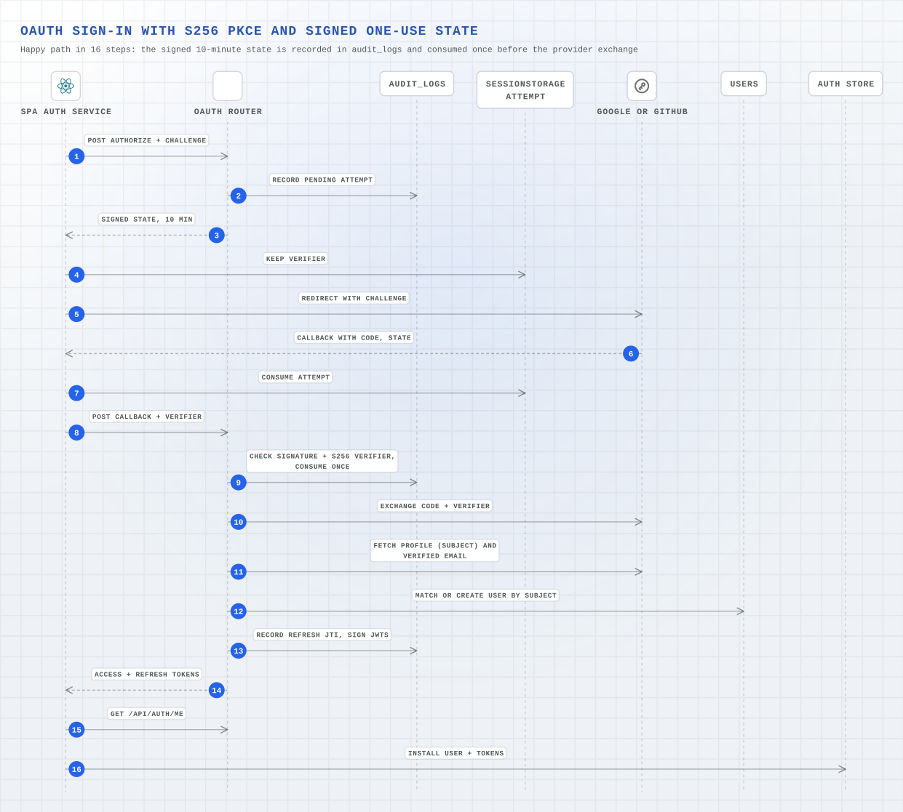

# Architecture and flow diagrams

Every figure here is drawn with [orrery](https://github.com/Sagargupta16/orrery)
from the YAML spec beside it. Each node and edge carries `evidence:` (the file
and line it comes from), so `orrery verify` fails when the code moves on. Each
figure has a light and a dark SVG (the embeds follow the reader's theme) and an
editable `*.drawio.svg` that diagrams.net and the VS Code Draw.io extension open
directly.

| Figure | Shows | Spec |
| --- | --- | --- |
| [System overview](#system-overview) | Hosting, the browser app, backend, database and outside services | [system-overview.yaml](system-overview.yaml) |
| [Backend layers](#backend-layers) | Routers, services, core, ingest and the ORM | [backend-layers.yaml](backend-layers.yaml) |
| [Statement import](#statement-import) | Parse, review, upload checks, reconcile, commit, analytics refresh | [statement-import.yaml](statement-import.yaml) |
| [Money Manager import](#money-manager-import) | A `.mmbak` from the Upload page or an iOS Shortcut: checks, UID-first reconcile, guard, repeat rules and budgets, commit | [money-manager-import.yaml](money-manager-import.yaml) |
| [Analytics boundaries](#analytics-boundaries) | Where each number comes from: rollups, SQL, Dashboard metrics, the ledger, the browser | [analytics-boundaries.yaml](analytics-boundaries.yaml) |
| [Shared finance rules](#shared-finance-rules) | Page hooks, lib/finance, the Dashboard metrics reads and the metric-rules mirror | [finance-composition.yaml](finance-composition.yaml) |
| [Chart kit](#chart-kit) | The in-house animated SVG chart kit and who uses it | [chart-kit.yaml](chart-kit.yaml) |
| [Session lifecycle](#session-lifecycle) | Startup, sign-out and identity changes | [session-lifecycle.yaml](session-lifecycle.yaml) |
| [Token refresh](#token-refresh) | One refresh per 401 with one-use rotation | [token-refresh.yaml](token-refresh.yaml) |
| [OAuth sign-in](#oauth-sign-in) | S256 PKCE with a signed one-use state, step by step | [oauth-sign-in.yaml](oauth-sign-in.yaml) |
| [AI chat](#ai-chat) | Funding modes, quota reservation and the tool loop | [ai-chat.yaml](ai-chat.yaml) |
| [Release delivery](#release-delivery) | CI checks, the migration gate, Pages and Vercel | [release-delivery.yaml](release-delivery.yaml) |

## System overview

<picture>
  <source media="(prefers-color-scheme: dark)" srcset="system-overview-dark.svg">
  
</picture>

## Backend layers

<picture>
  <source media="(prefers-color-scheme: dark)" srcset="backend-layers-dark.svg">
  
</picture>

## Statement import

<picture>
  <source media="(prefers-color-scheme: dark)" srcset="statement-import-dark.svg">
  
</picture>

## Money Manager import

<picture>
  <source media="(prefers-color-scheme: dark)" srcset="money-manager-import-dark.svg">
  
</picture>

## Analytics boundaries

<picture>
  <source media="(prefers-color-scheme: dark)" srcset="analytics-boundaries-dark.svg">
  
</picture>

## Shared finance rules

<picture>
  <source media="(prefers-color-scheme: dark)" srcset="finance-composition-dark.svg">
  
</picture>

## Chart kit

<picture>
  <source media="(prefers-color-scheme: dark)" srcset="chart-kit-dark.svg">
  
</picture>

## Session lifecycle

<picture>
  <source media="(prefers-color-scheme: dark)" srcset="session-lifecycle-dark.svg">
  
</picture>

## Token refresh

<picture>
  <source media="(prefers-color-scheme: dark)" srcset="token-refresh-dark.svg">
  
</picture>

## OAuth sign-in

Drawn as a sequence: the 16 steps run top to bottom across the lifelines.

<picture>
  <source media="(prefers-color-scheme: dark)" srcset="oauth-sign-in-dark.sequence.svg">
  
</picture>

## AI chat

<picture>
  <source media="(prefers-color-scheme: dark)" srcset="ai-chat-dark.svg">
  
</picture>

## Release delivery

<picture>
  <source media="(prefers-color-scheme: dark)" srcset="release-delivery-dark.svg">
  
</picture>

## Regenerate and verify

Install the orrery plugin (`claude plugin install orrery@orrery`) or clone the
repository, then run its CLI (`node <orrery>/skills/orrery/scripts/orrery.mjs`,
written `orrery` below) from the repository root:

```bash
# Every evidence entry must still point at a real file, line and identifier.
orrery verify docs/diagrams/backend-layers.yaml

# Score a figure at the width readers see it (README column: 880px).
orrery review docs/diagrams/backend-layers.yaml --width 880 -o docs/diagrams/backend-layers

# Write the light and dark SVGs and the editable draw.io copy.
orrery render docs/diagrams/backend-layers.yaml -o docs/diagrams/backend-layers -f svg --theme both --strict
orrery render docs/diagrams/backend-layers.yaml -o docs/diagrams/backend-layers -f drawio.svg --theme light --strict

# The OAuth figure ships as a sequence diagram.
orrery render docs/diagrams/oauth-sign-in.yaml -o docs/diagrams/oauth-sign-in -f sequence.svg --theme both --strict
```

Review output (`*.review.json`, `*.review.png`) and patch candidates are
gitignored scratch files.
